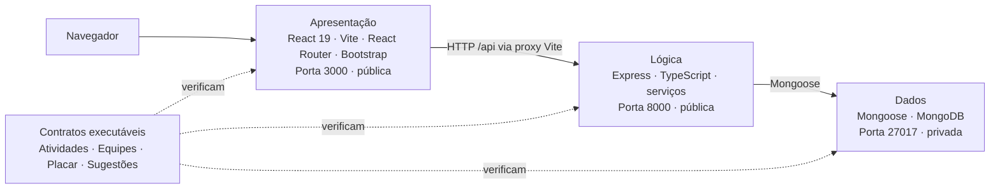

# Arquitetura do OctoFit Tracker

O OctoFit Tracker é uma aplicação de três camadas para um programa de atividades físicas escolar. O código inicial inclui contratos de API e pontos de implementação intencionalmente incompletos para que você use o modo agent do GitHub Copilot em um ciclo guiado por testes.

## Limites entre as camadas

- **Camada de apresentação**: React 19, Vite, React Router, Bootstrap e um cliente compartilhado da API em `octofit-tracker/frontend/src`.
- **Camada de lógica**: rotas e serviços Express com TypeScript em `octofit-tracker/backend/src` expõem o comportamento `/api/*` na porta `8000`.
- **Camada de dados**: modelos Mongoose e dados de demonstração em `octofit-tracker/backend/src/models` e `src/scripts/seed.ts` são persistidos no MongoDB na porta `27017`.

## Portas e regras de ambiente

- MongoDB: `27017` (privada)
- API Express: `8000` (pública)
- Interface Vite: `3000` (pública)
- O navegador acessa caminhos relativos `/api`. O Vite os encaminha para `http://localhost:8000`; `VITE_API_BASE_URL` pode substituir a URL-base.
- Não encaminhe nem torne públicas outras portas.

## Contrato da API

| Capacidade | Método e caminho | Comportamento esperado |
| --- | --- | --- |
| Registro de atividades | `GET /api/activities`, `POST /api/activities` | Lista e cria atividades válidas. POST recebe `userId`, `teamId`, `type` e `minutes`; `userId` e `teamId` devem ser IDs bem-formados de uma pessoa e uma equipe existentes, caso contrário a API retorna um 4xx intencional (nunca um 500 causado por erro de conversão). Uma atividade criada armazena `user`, `team`, `type` e `minutes` enviados, além de `points` e `occurredAt` calculados. |
| Equipes | `GET /api/teams`, `POST /api/teams` | Lista e cria equipes com integrantes. As equipes criadas e listadas mantêm os valores enviados em `name` e `mascot`. Rejeita uma equipe sem nome com `400`. |
| Placar | `GET /api/leaderboard` | Retorna as equipes ordenadas pela soma dos pontos de suas atividades, da maior para a menor. Cada item contém `teamName`, `totalPoints` e uma `rank` iniciada em 1. |
| Sugestões de treino | `GET /api/workouts/suggestions/:userEmail` | Recomenda treinos com base nos padrões de atividade recentes da pessoa correspondente ao e-mail seed. O foco da primeira sugestão (`focus`) corresponde à meta ou à atividade recente dessa pessoa, e o campo `reason` explica o motivo. Um e-mail sem pessoa correspondente retorna um 4xx intencional (por exemplo, `404`). |

## Decisões de implementação

- Decisão da camada de apresentação: manter as páginas React como consumidoras da API, usando o cliente compartilhado e caminhos `/api`; cada capacidade deve comunicar carregamento, erro e estado vazio com conteúdo acessível. Não colocar regras de negócio nem acesso ao MongoDB na interface.
- Decisão da camada de lógica: manter as rotas Express responsáveis pelo protocolo HTTP e concentrar validações e regras de negócio nos serviços. Validar entradas antes de consultar o Mongoose e traduzir entradas inválidas ou referências inexistentes em respostas 4xx, nunca em erros de conversão 500.
- Decisão da camada de dados: definir nos modelos Mongoose os campos e relações obrigatórios: pessoa com nome, e-mail e meta; equipe com nome, mascote e integrantes; atividade com pessoa, equipe, tipo, minutos, pontos e data; treino com título, foco, duração e dificuldade. Usar o seed da aplicação de forma idempotente, preservando registros não relacionados.
- Abordagem para registro de atividades: aceitar `userId`, `teamId`, `type` e `minutes`; validar formato e existência das referências; calcular pontos no serviço a partir dos minutos e gerar `occurredAt` no servidor. Não confiar em pontos ou data enviados pelo cliente.
- Abordagem para gerenciamento de equipes: exigir nome, preservar nome e mascote informados, usar lista vazia quando não houver integrantes e validar as referências dos integrantes antes de persistir. A listagem deve devolver os integrantes associados.
- Abordagem para o placar: somar os pontos das atividades por equipe, ordenar do maior total para o menor e atribuir posições começando em 1.
- Abordagem para sugestões de treino: localizar a pessoa pelo e-mail, priorizar treinos compatíveis com sua meta ou atividade recente e incluir uma justificativa legível; responder com 4xx quando a pessoa não existir.

## Plano de testes

- **Ordem segura**: validar modelos e seed antes dos serviços/rotas; validar o contrato da API antes de integrar a interface; executar as compilações após as suítes direcionadas. Corrigir uma camada antes de avançar para a seguinte.
- **Dados**: `npm run test:data --prefix octofit-tracker/backend` verifica campos obrigatórios, relações e seed representativo idempotente sem apagar dados não relacionados.
- **API**: `npm run test:api --prefix octofit-tracker/backend` verifica criação e listagem de atividades/equipes, rejeição de entradas inválidas, cálculo do placar e recomendações personalizadas.
- **Frontend**: `npm test --prefix octofit-tracker/frontend` verifica consumo da API e apresentação de dados, carregamento, estados vazios e erros acessíveis nas quatro capacidades.
- **Compilação**: `npm run build --prefix octofit-tracker/backend` e `npm run build --prefix octofit-tracker/frontend` verificam tipos e empacotamento de cada camada.
- **Validação do exercício**: `node --test tests/exercise-validation.test.mjs` verifica os metadados, os contratos protegidos e a composição do exercício; falhas aqui devem ser separadas das falhas funcionais do OctoFit.

### Linha de base antes da implementação

- `npm test --prefix octofit-tracker/backend`: 8 falhas e 1 aprovação. Falham os quatro contratos da API e as validações dos quatro modelos; o teste de seed idempotente passa.
- `npm test --prefix octofit-tracker/frontend`: 15 falhas. Os componentes ainda mostram o placeholder, portanto não atendem aos estados de dados, carregamento, vazio e erro.
- `node --test tests/exercise-validation.test.mjs`: 4 falhas e 38 aprovações. As quatro falhas são bloqueadas pelo mesmo contrato do README: o badge “Copy Exercise” precisa apontar para o template `dev-pods`; não devem ser interpretadas como quatro defeitos independentes do parser.
- As compilações ainda não foram executadas nesta linha de base.
